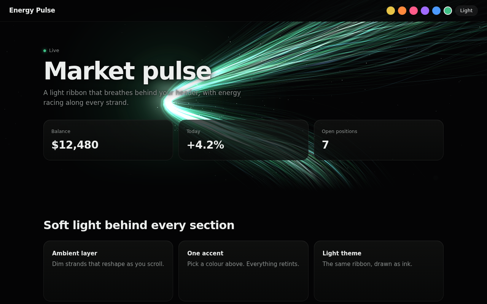

# Energy Pulse

**A glowing, breathing light ribbon for any website.** Hundreds of thin strands sweep behind your header and pinch
into a white-hot core that pulses. Light races along every strand, and a soft ambient glow follows you down the page.
It's one accent colour, works in dark and light themes, and has no dependencies.



It ships as an **AI design skill**: point your AI coding assistant at this repo and it applies the effect to your site.

## Get it with your AI

**Any AI assistant (Claude, ChatGPT, Cursor, Copilot, Windsurf, Codex...).** Paste this:

> Apply the energy pulse effect from https://github.com/rimidalvsulrod/energy-pulsing-effect-for-websites to my site.
> Follow `skills/energy-pulse/SKILL.md` in that repo and use my brand colour as the accent.

**Claude Code** (installs it as a skill, then just say "add the energy pulse"):

```
/plugin marketplace add rimidalvsulrod/energy-pulsing-effect-for-websites
/plugin install energy-pulse@energy-pulse
```

**Skills CLI** (Claude Code, Cursor, Codex, Gemini CLI, OpenCode and other agents that read `SKILL.md`):

```
npx skills add rimidalvsulrod/energy-pulsing-effect-for-websites
```

**Manual**: copy `skills/energy-pulse/` into your agent's skills folder (Claude Code: `~/.claude/skills/` or
`.claude/skills/` in your project).

## Use it without AI

Copy the files from `skills/energy-pulse/assets/` (`ribbon-engine.js`, `energy-pulse.js`, `energy-pulse.css`), then:

```html
<link rel="stylesheet" href="energy-pulse.css">

<header class="ep-hero">
  <canvas id="ep-ribbon" aria-hidden="true"></canvas>
  <h1>Your headline</h1>
</header>
<main><section>...</section></main>

<script type="module">
  import { energyPulse } from './energy-pulse.js';
  energyPulse({ accent: '#3fbf86', hero: '#ep-ribbon' });
</script>
```

Or straight from the CDN, with nothing to copy:
`https://cdn.jsdelivr.net/gh/rimidalvsulrod/energy-pulsing-effect-for-websites@main/skills/energy-pulse/assets/energy-pulse.js`
(and `energy-pulse.css`).

React / Next.js: `<EnergyPulse accent="#3fbf86"><h1>...</h1></EnergyPulse>` with `assets/EnergyPulse.tsx`.
All options are in [SKILL.md](skills/energy-pulse/SKILL.md).

## Demo

Run `npx serve .` (or any static server) in this repo and open `/`. Pick colours and switch to the light theme from the top bar.

## Details

- WebGL2, about 30 KB, no dependencies. The CPU only computes a few spine points per frame.
- Pauses off screen, steps down on slow devices, and shows a still frame for `prefers-reduced-motion`.
- Falls back to a static glow without WebGL2.

MIT licensed.
